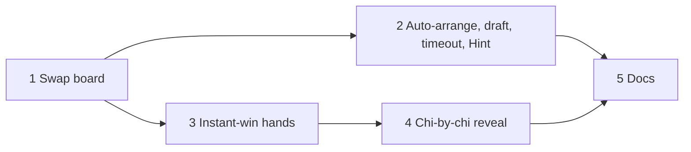

# Mau Binh swap board

## Overview

The game screen now shows a wrapped hand and three empty rows. The player must move 13 cards one at a time, and the wrapped hand is hard to use (`plans/game-screen-ui.md`). This plan copies the ZingPlay Mau Binh play screen. The game deals the 13 cards straight into the three rows, and the player drags one card onto another card to swap them.

Inputs:
- `plans/reports/brainstorm-260930-2343-game-screen-hand-layout.md` (option C)
- `plans/reports/research-260930-2343-mau-binh-play-screen-ux.md` (sections 5 and 7)

Mode: `--deep --tdd`. Phase 1 has full detail. Phases 2 to 5 have a scout step at the start of each cook run. Every phase writes the failing tests first.

## User decisions

| # | Decision |
|---|---|
| 1 | Swap input is drag only (pointer or keyboard drag). No tap-then-tap swap. No "swap chi 1 and 2" button. |
| 2 | Deal order is a device preference: raw (default) or sorted. It applies at each deal. A Sort button sorts cards inside each row. |
| 3 | Timeout uses the last valid draft from the client, else a greedy auto-arrange. The forfeit stays for surrender only. |
| 4 | A Hint button asks the server for the auto-arrangement. |
| 5 | Instant-win hands: the winner takes 3-0 (a sweep). Tie order: Dragon > Same color > Six pairs > Three flushes > Three straights. An equal kind is a draw. An instant win overrides a foul. |
| 6 | The result page reveals Front, then Middle, then Back, with a Skip button. |

## Phases

| # | Phase | Priority | Effort | Depends on | Status |
|---|---|---|---|---|---|
| 1 | [Swap board](./phase-01-swap-board.md) | P1 | 7h | none | Done |
| 2 | [Auto-arrange, draft sync, timeout, Hint](./phase-02-auto-arrange-timeout-hint.md) | P1 | 5h | 1 | Done |
| 3 | [Instant-win hands](./phase-03-instant-win-hands.md) | P2 | 4h | 1 | Done |
| 4 | [Chi-by-chi reveal](./phase-04-chi-by-chi-reveal.md) | P2 | 3h | 3 | Done |
| 5 | [Docs](./phase-05-docs.md) | P3 | 1h | 1, 2, 3, 4 | Done |

## Non-goals

- No change to the foul rule. A foul stays "Back weaker than Middle". The Mau Binh "Middle weaker than Front" rule is out of scope.
- No 3 or 4 player support.
- No auto-arrange search for Three flushes or Three straights. The greedy auto-arrange looks for the strongest Back only.
- No database schema change. Instant wins count as sweeps through the existing `p1_score = 3` rule in `apps/server/src/game/matchResults.ts`.

## Success criteria

- [x] The game screen deals 13 cards into Front 3, Middle 5, and Back 5 as a pyramid, with Front at the top. No separate hand exists.
- [x] A drag of one card onto another card swaps them, inside one row and across rows.
- [x] The deal-order preference and the Sort button work as decision 2 says.
- [x] At timeout, the server uses the last valid draft or the auto-arrangement. No timeout produces a forfeit.
- [x] The Hint button fills the board with the server auto-arrangement.
- [x] The five instant-win kinds are detected, scored, and shown on the board and the result page.
- [x] The result page reveals the rows one by one, and Skip shows everything at once.
- [x] `pnpm typecheck`, `pnpm lint`, `pnpm test`, and `pnpm test:e2e` pass.

## Main risks

- Repeated pointer drags in the sandboxed Chromium of `apps/e2e` are unreliable (see the comment on `removeCardFromGroup` in `apps/e2e/helpers/arrange.ts`). Phase 1 adds a keyboard drag path that jumps between cards. The full-arrangement e2e helper uses it.
- `RoundResult` gets new fields. The shared type, the server, and the web client change in the same phase so that they never disagree.

## Unresolved questions

None at plan time. Phase scouts can raise new questions.

## Red-team review (2026-10-01)

| Finding | Resolution |
|---|---|
| A fouled Three flushes board is blocked twice: the client foul warning disables submit, and `allowFoul` off rejects it on the server. | Phase 3 enables submit and skips the `allowFoul` rejection for an instant-win board. |
| A client can flood `game:hint_request`, and each request costs about 1,343 pokersolver comparisons. | Phase 2 caches `autoArrange` for each player in the game. |
| Pointer drags in the e2e Chromium are unreliable. | Phase 1 adds a keyboard drag path and uses it for full arrangements. |
| A page reload resets the board to the deal layout, but the server keeps the old draft. | Accepted. The next swap sends a new draft. The old hand flow had the same reset. |
