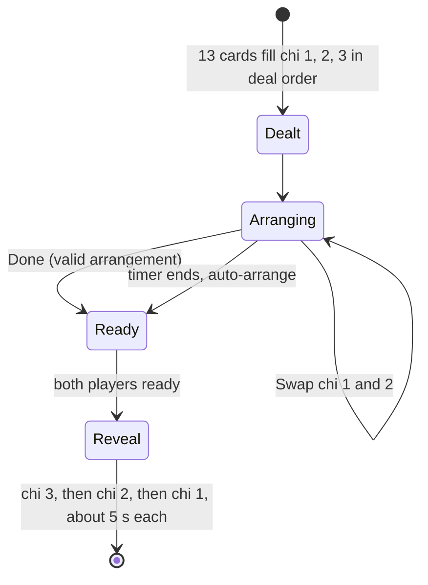

# Research: Mau Binh play screen UX

Date: 2026-09-30 23:43 (Asia/Bangkok).
Question: how do Mau Binh apps such as ZingPlay Mau Binh design the play screen, and what can Binh 13 copy?

## Answer

Mau Binh apps have no separate hand. The app deals the 13 cards straight into the three rows (chi). The player drags one card onto another card, and the two cards swap places. So the arrangement is always complete, and the player only improves it. Each row shows its hand name live, and a foul warning appears at once. A 90-second timer runs, and at timeout the app arranges the cards automatically instead of a forfeit. A hint button (goi y) also arranges the cards for the player. After both players finish, the app reveals the rows one at a time, about 5 seconds for each row.

Binh 13 can copy all of this on the client. The only server contract change is the timeout rule (auto-arrange instead of forfeit), and that change is optional.

## Contents

1. Evidence
2. Screen anatomy
3. Interaction model
4. Gap against Binh 13 today
5. Adoption plan
6. Next steps
7. Unresolved questions

## 1. Evidence

Confirmed by sources:

| Fact | Source |
|---|---|
| The player holds the mouse button and drags to swap the positions of cards. | [symbols.vn: Code Mau Binh ZingPlay](https://symbols.vn/code-mau-binh.html) (search summary of the ZingPlay guide) |
| The arrangement time is 90 seconds. At timeout, the system arranges the cards automatically. | Same source |
| A hint (goi y) option lets the machine arrange the cards. | [gamevh.net: Mau Binh guide](https://gamevh.net/cms/static/guide_maubinh.jsp) |
| The screen shows hand names such as Mau thau (high card), Doi (pair), Sam (trips). | gamevh.net guide |
| The reveal compares each chi in turn. Each step lasts 5 seconds and shows the cards, the hand name, and the updated win count. | gamevh.net guide |
| Chi order, the binh lung (foul) rule, and the instant-win hands (Mau binh toi trang). | [Wikipedia (vi): Mau binh](https://vi.wikipedia.org/wiki/M%E1%BA%ADu_binh) |
| Other Chinese Poker apps offer manual drag and automatic arrangement. | [Google Play: Chinese Poker (Five2)](https://play.google.com/store/apps/details?id=com.five2.play.chinesepoker&hl=en_US), [Google Play: Pusoy Offline 13](https://play.google.com/store/apps/details?id=danh.bai.mau.binh.offline&hl=en_US) |

Not confirmed by a source (general knowledge of these apps, and the user tried the app). Make sure that these points match your own memory of the app:

- The rows sit as a pyramid in the lower half of the screen: 3 cards at the top, 5 in the middle, 5 at the bottom.
- A tap on one card and then a tap on a second card also swaps them. This is the phone alternative to a drag.
- A button swaps chi 1 and chi 2 as whole rows. This is a fast fix for a foul.
- A "Xep xong" (done) button submits. The player can still change the cards until the opponent is ready or the timer ends.

Limits of the evidence: the app store pages did not load in full, and many Vietnamese guide sites are gambling mirrors. No screenshot of the ZingPlay screen was available to this research.

## 2. Screen anatomy

```text
+--------------------------------------------------+
| Opponent (card backs, ready badge)       ⏱ 90s   |
|                                                  |
|              [ Q♠ ][ 7♦ ][ 3♣ ]      Mau thau    |  chi 3 (Front, 3)
|        [ 9♠ ][ 9♥ ][ 5♦ ][ 4♣ ][ 2♠ ]   Doi      |  chi 2 (Middle, 5)
|        [ K♠ ][ K♦ ][ 8♣ ][ 8♥ ][ A♦ ]   Thu      |  chi 1 (Back, 5)
|                                                  |
|        ⚠ Binh lung  (shown only on a foul)        |
|   [ Swap chi 1 and 2 ]  [ Hint ]  [ Sort ]  [ Done ] |
+--------------------------------------------------+
```

Main points:

- The strongest row (chi 1) is at the bottom, closest to the player's thumb. The weakest row (chi 3) is at the top. This matches the physical table.
- Each row has one label on its right side. The label changes after each swap.
- Cards in one row sit next to each other with a small overlap on a phone. No row wraps.

## 3. Interaction model



Why this feels good:

- Every action is one swap. A swap never breaks the "5 / 5 / 3" shape, so the player never sees a half-empty board.
- The live labels and the foul warning give feedback after each swap. The player learns while playing.
- The timeout gives a fair result (an auto-arranged hand), not a loss. The player feels less stress.

## 4. Gap against Binh 13 today

| Mau Binh app | Binh 13 now | Where in code |
|---|---|---|
| Cards dealt into three rows | Cards start in a separate hand, and rows start empty | `apps/web/src/hooks/useArrangement.ts` |
| Drag card onto card to swap | Drag card from hand to a row, click row card to return it | `GameBoard.tsx` `handleDragEnd`, `GroupSlot.tsx` |
| Tap, then tap, to swap | Tap hand card, then tap empty slot | `GameBoard.tsx` `handleSlotClick` |
| Label for each row | Front label only (`frontLabel`) | `useArrangement.ts`, `GroupPanel.tsx` |
| Foul warning | Yes, "Possible foul" banner | `GameBoard.tsx`, `packages/shared/src/foulCheck.ts` |
| Hint (auto-arrange) | No | none |
| Timeout auto-arranges | Timeout forfeits with a foul arrangement | `apps/server/src/game/gameEvents.ts` (forfeit builder and timer expiry handler) |
| Reveal chi by chi | Result page shows all groups | `pages/Result.tsx`, `ResultGroupDisplay.tsx` |
| Front row at the top | Back row at the top | `GroupPanel.tsx` |

The client already has a rough 5-card category estimator (`estimateCategory` in `packages/shared/src/foulCheck.ts`, not exported). It can drive the live labels for chi 1 and chi 2 without pokersolver on the client.

## 5. Adoption plan

The work splits into three steps. Each step ships alone.

Step 1: the swap board (client only, fixes the reported problem).

- `useArrangement` starts with the cards dealt into `group1` (5), `group2` (5), and `group3` (3). The hand disappears.
- Replace assign and remove with one `swapCards(cardA, cardB)` action. It works inside a row and across rows.
- Each card is both draggable and droppable (`useDraggable` plus `useDroppable` from `@dnd-kit`). A drop on a card swaps the two cards.
- Tap one card to select it. Tap a second card to swap. Tap the same card again to cancel.
- Show the rows as a pyramid, Front at the top, with a label on each row. Export the category estimator from shared for the labels.
- Add a "Swap chi 1 and 2" button.
- `isComplete` becomes always true. Submit stays blocked on a definite foul (current `hasFoulWarning` rule).

Step 2: hint and timeout auto-arrange.

- Add an auto-arrange function in `packages/shared`, so the client hint and the server timeout use the same code. This follows the rule in `CLAUDE.md` to share evaluators, not fork them.
- A simple greedy method is enough: take the best 5-card hand for chi 1, the best of the rest for chi 2, and the last 3 cards for chi 3. It never fouls.
- On the server, the timer expiry handler submits the player's last arrangement or the auto-arrangement instead of the forfeit. This changes the game rule, so update `PLAN.md` and `docs/`.
- The client must send its current arrangement before the timer ends, or the server auto-arranges. A new "arrangement draft" event is one way. Surrender keeps the forfeit path.

Step 3: chi-by-chi reveal.

- On the result page, reveal chi 3, then chi 2, then chi 1, each with its hand name and a running score. Add a "Skip" button.

## 6. Next steps

1. Answer the unresolved questions below.
2. Run `/ak:plan` with this report and `plans/reports/brainstorm-260930-2343-game-screen-hand-layout.md`. Start with Step 1.
3. Update the Playwright e2e flow and the `useArrangement` tests for the swap model in the same change.

## 7. User decisions (2026-09-30)

These decisions replace the matching parts of sections 5 and 6.

1. Swap input: drag-to-swap only. No tap-then-tap swap and no "Swap chi 1 and 2" button.
2. Deal order: the player chooses. The default is raw deal order, so the player orders the cards alone. The other choice is auto-sorted by rank.
3. Timeout: switch to auto-arrange. The server uses the player's last arrangement or the shared auto-arrangement instead of the forfeit. Surrender keeps the forfeit.
4. Instant-win hands (Mau binh toi trang): in scope. The plan adapts the Wikipedia list (Sanh rong, Luc phe bon, 3 thung, 3 sanh, Dong mau) to the 2-player rules in `PLAN.md`.

## 8. Unresolved questions

- Instant-win details for the plan: the exact list, the rank order for a tie of two instant-win hands, and the score effect in a 2-player "win 2 of 3" game.
- Deal order choice: a per-player preference on the device, or a room setting in `docs/game-room-settings.md`.
